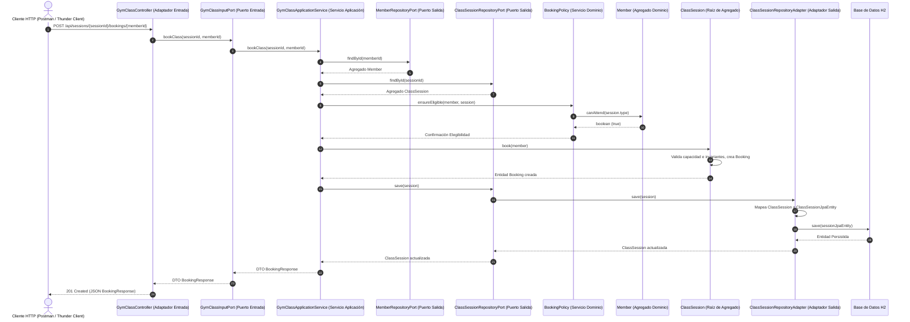

El caso de uso **Book
Class** permite a un socio reservar una clase dirigida. El siguiente diagrama
ilustra el flujo de secuencia de extremo a extremo desde el cliente HTTP hasta
la base de datos relacional H2:

